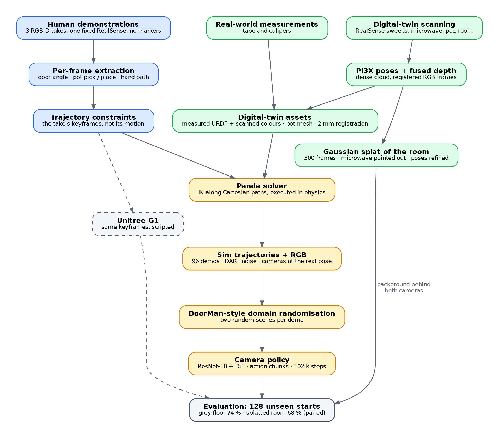

# Putting a pot in a microwave, from three human videos

Three 40-second RGB-D videos (one fixed RealSense) of me putting a Heinz Snap Pot into my
microwave become a Franka Panda doing the same task in a physics simulation of that
microwave and that pot. A scripted solver turns the videos' object keyframes into robot
demonstrations; a **camera-based policy** trained on them runs closed-loop from pot
positions it has not seen, on two camera images and its own joints, nothing privileged.
It succeeds **74 %** on a plain grey floor and **68 %** with both cameras looking at a
**3D Gaussian-splat reconstruction of my kitchen** it never saw in training (128 start
states each). Nothing here has run on a real robot.

## Demo

| human take (left) vs. simulation rendered from the same camera (right) |
|---|
|  |

| me (take 0, the real camera) vs. the camera policy, same camera, in the splatted kitchen, at a pot position it never saw |
|---|
|  |

| robot, solved from take 0 | the policy, a novel view of the splatted kitchen |
|---|---|
|  |  |

| the same keyframes on a Unitree G1 upper body -- scripted, not a policy, not evaluated |
|---|
|  |

The policy's inputs are the front camera (the real RealSense's registered pose and
intrinsics, 224 x 126) and a wrist camera (inset in the second GIF); in the splatted kitchen
each is the splat rendered from the camera's pose every step with the simulated robot,
microwave and pot drawn over it. Novel views are not inputs. The policy takes about 100 s for
what I do in 40 (GIFs: 3x human side, 8x robot side).
**Video (1080p, 18 s): [docs/media/policy_splat_kitchen_1080p.mp4](docs/media/policy_splat_kitchen_1080p.mp4).**

**Key result.** The submitted policy (v6-long), 128 unseen start states per column, the same
starts in both columns; success rate reached at each stage of the task:

| stage reached | grey floor | splatted kitchen (both cameras) |
|---|---|---|
| door opened | 100 % | 100 % |
| pot grasped and lifted | 90 % | 77 % |
| pot inside the microwave | 84 % | 72 % |
| door shut with the pot inside | 75 % | 69 % |
| **task success** | **74 %** | **68 %** |

Grey floor vs kitchen, paired: 21 / 13 discordant, p = 0.23 on these starts; on 128 new
starts 78 % vs 63 %, 28 / 9, p = 0.003. The kitchen was never a training scene; it costs
the policy 6-15 points, all at the grasp, nothing at the door. Single numbers carry about
+-5 points of sampling noise (the grey-floor run repeated: 79 % on the same starts), and a
second training run of the same recipe on the corrected pot gives 73 % / 49 %: the kitchen
number also moves a lot with the training run.

## Method

\* with the lid texture the policy was trained on (orange rim); with the corrected pot,
74 % / 68 % ([`REPORT.md`](REPORT.md)).

The human video contributes the task's keyframes and the camera; the measured twin and the
solver contribute the motion; the room enters only at evaluation, never in training. The G1
branch is a single scripted run outside the evaluation.

What the front camera sees -- the real frame, the splat composite, the earlier mesh scan:

**The splatted kitchen** (evaluation only): 300 frames of a RealSense sweep of the room,
posed by Pi3X in batches anchored to a 60-frame global solve; the microwave painted out of
every frame with LaMa (its known box projected at each pose); a gsplat 3DGS with per-view
pose refinement (held-out PSNR 26.5 dB); rendered per camera pose and composited by
segmentation (`recon/sweep_dense.py`, `gs_inpaint.py`, `gs_kitchen.py`; `sim/gs_demo.py`;
`dit_vis.py eval --real-bg --splat-wrist`; `sim/EXPERIMENTS.md` 7e).

Code: `capture/` (recording), `recon/` (scan -> assets, take -> keyframes, room -> splat),
`sim/` (environment, solver, data generation, rendering, policy, splat compositing),
`archive/` (demoted but kept as evidence, indexed in `archive/README.md`).

## Conclusions, statements and future work

**Statement.** I found this challenge on 13 October, four days before the deadline, and
chose the route that could reach a complete, measured result in that time: a digital twin,
a scripted solver, an imitation policy, and a thorough evaluation of each. The world-model
route the brief invites -- the collected video as the training data, the simulator only as
the exam -- is the one I would take with the full two weeks; its design, and why this
repo's own results point to it, is below and in `FUTURE_DIRECTIONS.md` 10. After the
challenge I will continue this project and carry out those world-model experiments at
[github.com/HanshangZhu/V-JEPA_kitchen](https://github.com/HanshangZhu/V-JEPA_kitchen) --
check it if you are interested. Thank you for the challenge; it was a good four days.

**What the experiments say, in short.** Steps, model size and demonstration count are not
what limits this policy (~80 %, all n.s.); one random scene per demonstration costs ~20
points; in the real-looking room the two cameras disagreeing cost 21 points and the room
itself 6-15; a 7 mm band of lid colour the asset had wrong costs 9; and wherever a
scripted oracle exists, human motion used as action labels loses to it (59 % vs 88 % at
matched demo counts). Numbers and tests: [`REPORT.md`](REPORT.md) and `sim/EXPERIMENTS.md`.

**What they point to.** The last two results are the ones that matter, and together they
say the human data was used on the wrong side of the pipeline.

Used as *action labels* -- retargeted and imitated -- a human hand trajectory is noise
relative to a solver that already produces perfect actions for this task, in this region,
for free. That is structural, not a tuning problem: the hand is not a gripper, the cavity
hides it, and the simulator is a better demonstrator of robot actions than any human can
be. This repo measured that loss and could not have avoided it by any amount of retargeting.

Used as *video*, the same takes carry exactly what the simulator cannot produce: how a real
door, a real pot and a real room look and move under manipulation. No action labels are
needed to learn that -- it is what the video head of a world model learns -- and the
measured sensitivities of the policy here (to the room, to a 7 mm band of print, to the two
cameras disagreeing) are sensitivities a model trained on real video need not have.

So the design this project should have had, and the one I would build with the time:

1. **Scale ego-motion video.** Head- or chest-mounted RGB(-D), hundreds of takes rather
   than three, many objects, many rooms; the wrist pose tracked as the action proxy. It is
   the cheapest data in robotics to collect, and the only kind that is unlimited.
2. **Train the video head of a world-action model on it** (V-JEPA 2-style predictor, or the
   video branch of a WAM such as LingBot-VA): the model learns scene dynamics and
   appearance from human video alone. Where the data are few, the object-centric variant
   (`FUTURE_DIRECTIONS.md` 10: predict pot pose and door angle from wrist motion) is the
   minimal instance of the same idea and fits three takes. This is where the project
   continues: [V-JEPA_kitchen](https://github.com/HanshangZhu/V-JEPA_kitchen).
3. **Align the action head separately, with the robot's own embodiment**: SFT on simulated
   or teleoperated robot demonstrations, then RL in the twin -- where success is measurable
   and the scripted oracle is worth something as a critic and a reward, not as a
   demonstrator. The human never labels robot actions; the robot's actions are learned
   where they can be scored.
4. **Use the simulator as the exam, not the data source.** The twin and the splatted room
   are where a policy is tested across starts, rooms and bodies; the real world is where
   the model learns what the world looks like. This inverts the pipeline in this repo, in
   which simulation produced the data and the real room appeared only as a backdrop.
5. **Then change the body.** With the dynamics in the video head and the actions aligned
   per embodiment, the Panda -> G1 step is an action-head problem, not a data problem:
   a whole-body G1 in Isaac Lab on an existing whole-body controller
   (`FUTURE_DIRECTIONS.md` 9).

What this repo contributes to that plan is the part that is hard to skip: a registered
digital twin, per-frame object extraction (the object-centric state the world model would
predict), a splatted room that closes the visual gap, the finding that the cameras must
agree, and a measured demonstration of why the alternative -- human motion as labels --
does not work. None of the plan above is tested here; it stands on a negative result and
on the brief's own weighting of world modelling over policy performance. That is where I
would put the two weeks, and where the work goes next: [V-JEPA_kitchen](https://github.com/HanshangZhu/V-JEPA_kitchen).

## Where to look

- [`REPORT.md`](REPORT.md) -- the long form: design choices and why, full results and
  ablations, what did not work, the humanoid run, limitations.
- [`REPRODUCE.md`](REPRODUCE.md) -- how to run it: a 40-minute route from the released
  policy and demonstrations ([Release v1.0](https://github.com/HanshangZhu/microwave-from-human-video/releases/tag/v1.0)),
  and the full route from the captures. The raw recordings of my home are not published;
  write to zcabhz4@ucl.ac.uk.
- [`sim/EXPERIMENTS.md`](sim/EXPERIMENTS.md) -- every data / policy / RL run with its
  command and numbers, as it happened; `docs/MICROWAVE_LOG.md` is the short version.
- [`FUTURE_DIRECTIONS.md`](FUTURE_DIRECTIONS.md) -- the world-model design this should have
  had (10), the whole-body G1 (9), and earlier notes; the work continues at
  [V-JEPA_kitchen](https://github.com/HanshangZhu/V-JEPA_kitchen).
- `recon/DEMOS.md`, `assets/microwave/README.md`, `recon/ASSET_ISSUES.md` -- what was
  extracted from each take; the assets, measured vs guessed, and their problems as found.
- `archive/` -- demoted code kept as evidence, indexed in `archive/README.md`.
