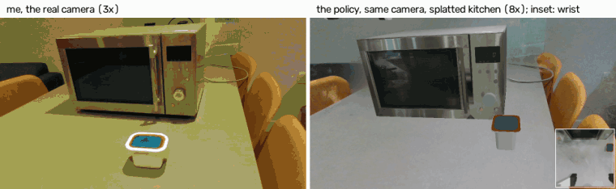
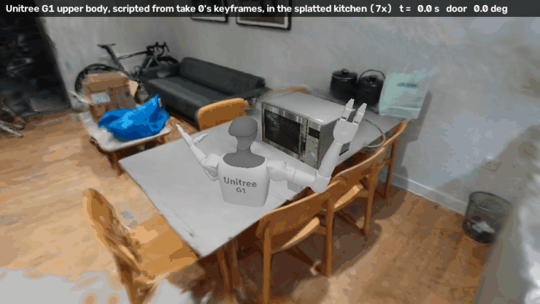

# Putting a pot in a microwave, from three human videos

Three 40-second RGB-D videos (one fixed RealSense) of me putting a Heinz Snap Pot into my
microwave become a Franka Panda doing the same task in a physics simulation of that
microwave and that pot. A scripted solver turns the videos' object keyframes into robot
demonstrations; a **camera-based policy** trained on them runs closed-loop from pot
positions it has not seen, on two camera images and its own joints, nothing privileged.
It succeeds **74 %** on a plain grey floor and **68 %** with both cameras looking at a
**3D Gaussian-splat reconstruction of my kitchen** it never saw in training (128 start
states each; with the lid texture it was trained on, which got the pot's rim colour wrong,
83 % and 77 % -- see "A 7 mm finding"). The same keyframes also drive a Unitree G1 upper
body through the task, scripted. Nothing here has run on a real robot.

| human take (left) vs. simulation rendered from the same camera (right) |
|---|
|  |

| me (take 0, the real camera) vs. the camera policy (v6-long), same camera, in the splatted kitchen, at a pot position it never saw |
|---|
|  |

| robot, solved from take 0 | the policy, a novel view of the splatted kitchen |
|---|---|
|  |  |

The policy's inputs are the front camera (the real RealSense's registered pose and
intrinsics, 224 x 126) and a wrist camera (inset); here each is the splat rendered from the
camera's pose every step with the simulated robot, microwave and pot drawn over it. The
bottom-right GIF is a novel view, not an input.
**Video (1080p, 18 s): [docs/media/policy_splat_kitchen_1080p.mp4](docs/media/policy_splat_kitchen_1080p.mp4).**
The policy takes about 100 s for what I do in 40 (GIFs: 3x human side, 8x robot side).


**The splatted kitchen:** 300 frames of a RealSense sweep of the room, posed by Pi3X in
batches anchored to a 60-frame global solve; the microwave painted out of every frame with
LaMa (its known box projected at each pose); a gsplat 3DGS with per-view pose refinement
(held-out PSNR 26.5 dB); rendered per camera pose and composited by segmentation
(`recon/sweep_dense.py`, `gs_inpaint.py`, `gs_kitchen.py`; `sim/gs_demo.py`; `dit_vis.py eval
--real-bg --splat-wrist`; `sim/EXPERIMENTS.md` 7e).

v6-long on the same 128 starts, with the lid texture it was trained on (orange rim):

| background | success | vs grey floor (discordant, p) |
|---|---|---|
| grey floor (the kind of floor it was trained on) | 83 % | -- |
| scanned mesh of the room, uncoloured (noisy; `EXPERIMENTS.md` 7d) | 81 % | 14 / 12, p = 0.85 |
| Gaussian splat of the room, front camera only (wrist: grey floor) | 62 % | 34 / 8, p = 0.0001 |
| **Gaussian splat of the room, both cameras** | **77 %** | 21 / 13, p = 0.23 |

The room's look costs little; what cost 21 points was the two cameras disagreeing (a real
room in front, the grey grid at the wrist) -- in training both always see the same
randomised scene. Both-cameras beats front-only 26 / 8 (p = 0.003). One training seed.

With the corrected lid (white rim -- the asset in this repo and in the GIFs): grey floor
**74 %** (vs 83: 19 / 8, p = 0.05), splat with both cameras **68 %** (vs 77: 18 / 7,
p = 0.04); grey vs splat 21 / 13, p = 0.23, as before.

Task, in order: open the door by its pull handle, pick the pot up from the counter, put it
on the turntable, shut the door. Success = the pot inside on the turntable **and** the
door < 5 deg. Physics: ManiSkill3 / SAPIEN 3.0.3, PhysX CPU, 20 Hz joint-position control,
episodes up to 3000 steps.

## Results

| stage | what | result |
|---|---|---|
| capture | 3 takes x 40 s, RealSense D435i, fixed camera, no markers | 0 depth frames dropped |
| twin | microwave: tape-measured URDF + scanned colours; pot: measured mesh | per-frame registration 2.0-2.2 mm rmse, 79 / 80 frames kept |
| extraction | per take: door angle per frame, pot pick / place, hand | all 3 takes (`recon/DEMOS.md`) |
| solver | each take reproduced by the Panda in physics | 3 / 3 |
| data | new pot / place positions in the region the takes span | 58 / 60 clean; 34 / 80 at DART sigma 0.02 rad; 4 / 40 at 0.04 = 96 demos |

Policies, all evaluated closed-loop on the **same 128 start states** (paired McNemar tests in
`sim/EXPERIMENTS.md`), orange-rim lid throughout:

| policy | input | grey floor | scanned-room mesh (never trained on) |
|---|---|---|---|
| DiT + action chunking, clean data | privileged state (pot pose, door angle) | 0 % (n = 20) | -- |
| DiT + action chunking, clean + DART | privileged state | 70 % | -- |
| v4: ResNet-18 + DiT, one clean scene, 49 k steps | 2 images + 25 robot numbers | **97 %** | **0 %** |
| v6: + domain randomisation, 2 scenes per demo, 49 k steps | same | 65 % | 70 % |
| **v6-long: v6 trained 102 k steps (submitted policy)** | same | **83 %** | **81 %** |

v4 is the best policy in the scene it was trained in and useless outside it; v6-long gives
up 14 points there and holds in rooms it never saw.

## The pipeline

```
capture/   laptop: scan.py (environment + object scans), record.py (task takes)
   |
recon/     scan -> measured + textured assets; take -> object keyframes
   |         microwave: tape measurements -> URDF (assets/microwave/build_microwave.py)
   |                    scan -> Pi3X poses + fused RealSense depth -> registration -> colour bake
   |         takes:     camera anchor -> door angle / pot pick & place / hand per frame
   |                    -> replay video (recorded frame | sim from the same camera)
   |         kitchen:   sweep -> Pi3X poses -> LaMa (microwave out) -> gsplat 3DGS
sim/       MicrowavePot-v0 (ManiSkill3 / SAPIEN)
             solve_microwave.py  IK along Cartesian paths, executed in physics
             generate.py         new start states in the takes' region (+ DART noise)
             render_views.py     front (the real RealSense pose + intrinsics) and wrist
                                 images re-rendered from stored states; --dr: random scenes
             dit_vis.py          camera policy: image + joint tokens -> DiT action chunks
             gs_demo.py, gs_client.py   the splat behind the simulator's cameras
             dit.py, bc.py       privileged-state policies (test bed)
             rl_cpu.py, dagger.py   residual PPO and DAgger on the state policy (negative)
             human_paths.py      partial retargeting: the hand's tracked paths as solver constraints
```

## Design choices, and why

**The human video gives task keyframes, not motion.** Hand tracking (MediaPipe + depth) is
good while the hand reaches and carries, but the hand is invisible inside the dark cavity,
exactly where the place happens, and it is not a parallel gripper. What the video gives
reliably is what happened to the *objects*: the door angle per frame (fitted from depth
against the known door), where the pot was picked and put down, and the order. The robot's
motion is solved for those.

**Measured, not reconstructed, geometry.** A microwave is a box with a door; a tape
measure takes ten minutes. The scan supplies *where* it is and *what colour* it is.
Reconstructing it failed usefully: round a box, Pi3X confuses back and front views and the
fused cloud grows a second door (`recon/ASSET_ISSUES.md`). Each metric RealSense frame is
registered to the known model instead; colours are baked on with ray-cast visibility.

**No markers.** The camera pose of each take comes from registering the take's last seconds
(scene at rest) to the model; a knocked camera is detected from the background's image
shift and the earlier segment re-registered.

**A solver, not a motion planner.** Every motion is IK along a dense Cartesian path,
executed in physics, so a run either works physically or shows where it fails. The door is
carried round its hinge 1 deg at a time; the door is shut with up to three regrasps.

**DART noise.** With clean solver data both state policies leave the demonstrations and
never come back (0 %). Re-solving with smooth random offsets on the executed joint targets
while recording the clean ones gives recovery examples: 0 -> 65 %.

**Training length was the bug, found by a control.** Three camera policies (small CNN,
ResNet-18, frozen DINOv2) all failed at 12 k steps; so did a control fed the *privileged
state* through the same pipeline, which ruled out vision. 4x the steps (+ EMA) gave v4,
5 -> 97 %. The same happened again with randomisation (v6 65 % -> v6-long 83 % at 2x steps).

**Domain randomisation, DoorMan-style.** v4 learned the scene: 97 -> 0 % with the scanned
kitchen as a backdrop. v6 renders every demo in two random scenes (`sim/dr.py`: 40 Poly
Haven environment maps as background and light, random floor / walls / lights, tinted
objects, a jittered camera) with colour jitter, blur and random erasing in training. The
kitchen is never a training scene.

## What the human data did, and why the simulator hides its value

The hand's tracked paths can also set *how* the robot moves (partial retargeting, as in
EgoEngine / X-Sim: `sim/human_paths.py`): the solver follows the wrist for the approach and
the carry and plans the last 10 cm and the insertion itself. Trained as v4, same starts,
matched demo counts:

| comparison | success | |
|---|---|---|
| solver approach + carry vs human approach + carry, 86 demos | 88 % vs 59 % | p < 0.0001 |
| solver carry vs human carry only, 81 demos | 78 % vs 66 % | p = 0.03 |
| same solver data, 71 / 81 / 94 demos | 48 / 78 / 90 % | |

Not the path's jerk (smoothed: still 59 %), not the mix of takes (one take: 65 %). The
failure, a premature close in front of the pot, also appears with no human data when demos
are few or carry low: it is what this policy does off a thin distribution. **Demo count
matters most, and human paths cost success here** -- unavoidably, because the solver is a
free, perfect oracle for exactly this task in exactly this region. Human data earns its keep
where no such oracle exists; this setup cannot show that, and I do not claim it.

## A 7 mm finding: the policy keys on the object's print

Found from the final video: the real Snap Pot has a white plastic rim round its lid; the
asset's lid texture had painted it orange for three days. Geometry measured and registered
to 2 mm, and nobody looked at the colour of a 7 mm band. The unchanged policy, same 128
starts: grey floor 83 -> 74 %, splatted kitchen 77 -> 68 % (19 / 8 and 18 / 7, p = 0.05 /
0.04). The failures spread over grasp, insertion and shutting the door, so the pot did not
become hard to see; the policy's picture of "the pot" includes its orange top. The
randomisation varied scenes, lights and image colour, never the manipulated object's own
appearance -- the one thing the policy must read precisely. Object appearance belongs in
the randomisation, and a real-to-sim pipeline needs an appearance check against the photos
as routine as its geometric residuals. Whether a short fine-tune on the corrected pot
recovers the 9 points: `sim/EXPERIMENTS.md` 7f.

## What did not work, or only partly

- **Day 1 (archived):** a finger pressing a bottle cap -> RoboTwin `click_bell` ->
  post-training LingBot-VLA-2 made it *worse* (75 -> 50 %, p = 0.0003); a BF16 time grid
  in its sampler cost 18 points, reported upstream
  ([Robbyant/lingbot-vla-v2#59](https://github.com/Robbyant/lingbot-vla-v2/pull/59)).
- **Residual RL (PPO) on the state policy:** +5.4 points at best, not significant; the same
  checkpoint scores 70 % in PhysX CPU and 35 % in PhysX GPU, so everything stays in CPU
  physics.
- **DAgger with the solver as expert:** 69.5 -> 15.6 %; the "restart" labels contradict the
  demos near the pot.
- **Bigger, longer, more data: one plateau** (grey / scanned room, paired with v6-long's
  83 / 81 %): 3x the steps 80 / 72 %; a 7x larger transformer 80 / 77 %; 2.1x the demos
  (205) 82 / 80 % -- all n.s. Steps, capacity and data are not the limit at ~80 %.
- **One random scene per demo hurts:** the same 96 demos in one scene each, 64 / 58 %
  (p <= 0.001); 205 demos in one scene each, 38 / 45 %. Consistent with the background
  identifying the demo; the 205 x 1 result is unexplained, and training-seed variance was
  never measured (one run per arm).
- **NVIDIA Newton** (`sim/newton_spike/`): reproduces the solver at a 0.002 s timestep, not
  at ManiSkill's 0.01 s; five importer traps; not adopted (`EXPERIMENTS.md` 10).

## The same pipeline on a humanoid (scripted only)

| Unitree G1 upper body (ManiSkill), solved from take 0's keyframes, re-filmed in the splatted kitchen |
|---|
|  |

The take's keyframes drive a second body with no change to the extraction: left hand hooks
the handle and opens the door to 76 deg, right hand carries the pot onto the turntable, left
hand shuts the door (`sim/g1_spike/`, `EXPERIMENTS.md` 9). Scripted IK, not a learned policy,
and narrow (door 60-75 deg, pot yaw 11-21 deg, no collision checking). ManiSkill's
upper-body G1 has no legs and its pelvis sits at counter height, so re-filmed
(`sim/g1_spike/replay_splat.py`, recorded states replayed, the part below the counter hidden
by the table) it looks mounted at the table. Next: a whole-body G1 in Isaac Lab balanced by
an existing whole-body RL controller (NVIDIA SONIC), fed these hand trajectories, then G1
demonstrations and the same camera-policy recipe (`FUTURE_DIRECTIONS.md` 9).

## Limitations

- Simulation only. One task, one microwave, one pot, one training seed per variant.
- The pot's start region is the one the takes span (10 x 14 cm); v4 falls to 47 % within
  2.5 cm beyond its edge and 0 % beyond 5 cm; with the pot on top of the microwave the door
  is never opened. v6-long was not tested outside it.
- The splatted kitchen is the room's look, not a real image: the robot, microwave and pot
  are simulator renders over it, without shadows on the real table; the splat is blurry
  close up and where the sweep did not look; the ceiling is a flat grey.
- The policy keys on the pot's own print (above); the object's appearance was never
  randomised.
- Hinge friction / damping and the pot's mass are set, not measured.
- Rollouts are not bit-identical across machines (x86 vs aarch64 PhysX); every comparison is
  paired on one machine. Offline validation error does not predict closed-loop success.

## Running it

Hardware: a laptop with a RealSense D435i; a desktop with an RTX 5090 (training, rendering,
evaluation); a DGX Spark and a Jetson Thor for extra runs. Conda environments
(`PYTHONNOUSERSITE=1` throughout):

| env | used for | key packages |
|---|---|---|
| `realsense` / `rscap` | `capture/`, `recon/capture_to_r2s.py` | pyrealsense2 2.58, opencv |
| `3dgrut` | Pi3X, fusion, registration, colour bake, `recon/sweep_dense.py` | torch 2.11, open3d 0.19, [Pi3](https://github.com/yyfz/Pi3) (`PI3_ROOT`) |
| `handtrack` | `recon/hand_track.py` | mediapipe 1.1 |
| `maniskill` | `sim/`, `recon/replay_take.py`, `recon/door_track.py` | mani_skill 3.0.1, sapien 3.0.3, torch 2.11 |
| `sam3d` | `recon/gs_kitchen.py`, `gs_inpaint.py`, `gs_server.py` (the splat) | torch 2.7, gsplat 1.5.3, open3d |

Raw captures, demonstrations, renders, HDRIs and checkpoints live in the gitignored
`Gitignore-but-important/` (not public).

```bash
# 1. capture (laptop) -- see capture/README.md
python capture/scan.py env --out scans/microwave
python capture/record.py --out captures/microwave01 --count 3 --duration 40 --reset 15

# 2. microwave asset: measured URDF, then the scanned colours
python assets/microwave/build_microwave.py && python assets/microwave/check_microwave.py
bash recon/scan_to_textured.sh <scan dir> assets/microwave/microwave.urdf <work dir> closed open_90

# 3. takes -> keyframes and replay (recon/DEMOS.md)
python recon/take_anchor.py captures/microwave01 take_000 --out takes/take_000
python recon/register_model.py takes/take_000 takes/take_000/run --urdf assets/microwave/microwave.urdf --seed "0 300 60 800 400"
python recon/door_track.py captures/microwave01 take_000 --anchor takes/take_000
python recon/pot_track.py  captures/microwave01 take_000 --anchor takes/take_000
python recon/hand_track.py captures/microwave01 take_000 --anchor takes/take_000   # (env handtrack)
python recon/replay_take.py captures/microwave01 take_000 --anchor takes/take_000

# 4. robot demonstrations (G = Gitignore-but-important/sim)
python sim/solve_microwave.py --take take_000 --out $G/take_000
python sim/generate.py --n 60 --out $G/gen --jobs 10
python sim/generate.py --n 80 --seed 2 --dart-noise 0.02 --jobs 14 --videos 0 --out $G/gen_dart02
python sim/generate.py --n 40 --seed 3 --dart-noise 0.04 --jobs 14 --videos 0 --out $G/gen_dart04

# 5. camera images, two random scenes per demo; 6. the camera policy and its evaluations
for v in 0 1; do python sim/render_views.py --data $G/gen,$G/gen_dart02,$G/gen_dart04 --jobs 2 --dr doorman --variant $v; done
python sim/dit_vis.py train --data $G/gen,$G/gen_dart02,$G/gen_dart04 --out $G/vis_v6_long --epochs 240 \
    --encoder resnet18 --views views_drm0,views_drm1 --ema --erase 0.3 --color-aug
python sim/dit_vis.py eval --ckpt $G/vis_v6_long/dit_vis.pt --out $G/vis_v6_long/eval128 --n 128 --jobs 6
python sim/dit_vis.py eval --ckpt $G/vis_v6_long/dit_vis.pt --out $G/vis_v6_long/eval128_kitchen --n 128 --jobs 6 \
    --backdrop Gitignore-but-important/recon/kitchen/backdrop_mw.glb   # recon/kitchen_backdrop.py

# 7. the kitchen as a Gaussian splat (env 3dgrut, then sam3d), and the policy in it
K=Gitignore-but-important/recon/kitchen
python recon/sweep_dense.py Gitignore-but-important/laptop/kitchen closed $K/closed --out $K/closed_dense --batch 16 --anchors 24
python recon/gs_inpaint.py --lama big-lama.pt --sweep $K/closed_dense --out $K/gs_inpaint_dense --dilate 18   # github.com/enesmsahin/simple-lama-inpainting
python recon/gs_kitchen.py train --out $K/gs_dense_po --steps 20000 --sweep $K/closed_dense --inpainted $K/gs_inpaint_dense --pose-opt --holdout 8
python sim/gs_cams.py --out $K/gs/cams_front.npz && python sim/gs_cams.py --demo --out $K/gs/cams_demo.npz
python recon/gs_kitchen.py render --keep-all --ckpt $K/gs_dense_po/ckpt.pt --cams $K/gs/cams_front.npz --out $K/gs_dense_po/bgall_front.npz
python sim/dit_vis.py eval --ckpt $G/vis_v6_long/dit_vis.pt --out $G/vis_v6_long/eval128_gs_both --n 128 --jobs 6 \
    --real-bg $K/gs_dense_po/bgall_front.npz --splat-wrist $K/gs_dense_po/ckpt.pt
python sim/gs_demo.py --ckpt $G/vis_v6_long/dit_vis.pt --front $K/gs_dense_po/bgall_front.npz --splat-wrist $K/gs_dense_po/ckpt.pt \
    --demo $K/gs_dense_po/bgall_demo.npz --cams $K/gs/cams_demo.npz --out <dir>   # the video's frames
```

Each script's docstring states what it does, why, and its flags. On the Jetson Thor, add
`--tasks-per-child 4` to evaluations.

## Where to look

- `sim/EXPERIMENTS.md` -- every data / policy / RL run with its command and numbers.
- `docs/MICROWAVE_LOG.md` -- the same story in short, as it happened.
- `recon/DEMOS.md` -- what was extracted from each take, and how.
- `assets/microwave/README.md`, `recon/ASSET_ISSUES.md` -- the assets: measured vs guessed,
  and the pipeline's problems as they were found and fixed.
- `FUTURE_DIRECTIONS.md` -- when human video is needed at all, a wrist IMU for the occluded
  part, ego video as a video-prediction target, the whole-body G1 in Isaac Lab.
- `docs/viz/` -- step-by-step visualisation of solver vs human-guided demonstrations.
- `archive/2026-10-13-human-press/` -- day 1.

## How this was built

Four days, 13-16 Oct 2026. An AI coding agent (Claude Code) wrote and ran the code and the
experiments; a second agent built the pot asset. My part: the task, the recordings and
measurements, splitting the work across three machines, and the decision at each fork --
some my own, some picked from the agent's proposals: cabinet -> microwave; measured instead
of reconstructed geometry; a solver instead of retargeting the hand; DART; the camera
policy and its randomisation; that v6 was undertrained; on the last day, the splat instead
of patching the mesh, painting the microwave out before training, adding frames when the
splat looked unconverged, and noticing that the policy's wrist input was still the bare
simulator, which turned the front-only 62 % into the two-camera 77 %; and that the pot's rim
was the wrong colour. Every number above comes from the scripts in this repo.
