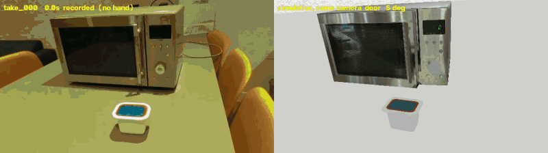
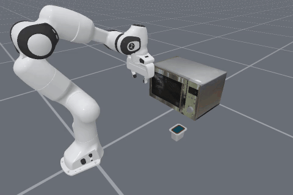
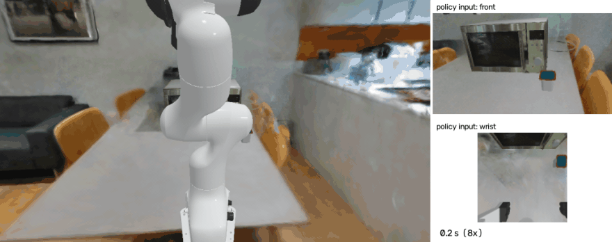
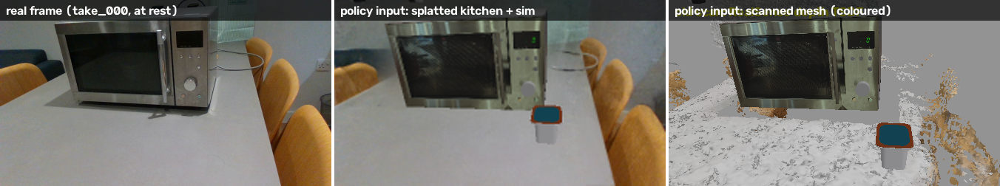

# Putting a pot in a microwave, from three human videos

Three 40-second RGB-D videos (one fixed RealSense) of me putting a Heinz Snap Pot into my
microwave become a robot (Franka Panda) doing the same task in a physics simulation of
that microwave and that pot. A scripted solver turns the videos' object keyframes into
robot demonstrations, and a **camera-based policy** trained on them runs closed-loop from
pot positions it has not seen. It sees two camera images and the robot's own joints, and
nothing privileged. It succeeds **83 %** on a plain grey floor (128 unseen start states),
and **77 %** with both cameras looking at a **3D Gaussian-splat reconstruction of my
kitchen** instead -- the table, chairs and room it never saw in training, with the robot,
microwave and pot rendered by the simulator in front of it (not a significant drop: 21 / 13
discordant, p = 0.23). Nothing here has run on a real robot.

| human take (left) vs. simulation rendered from the same camera (right) |
|---|
|  |

| robot, solved from take 0 | camera policy (v6-long) in the splatted kitchen, unseen pot position |
|---|---|
|  |  |

Right: a novel view of the splatted kitchen (not a policy input), 8x speed, with the policy's
two inputs beside it: the front and wrist cameras, each the splat (rendered from the camera's
pose every step) with the simulated objects drawn over it. A 1080p version with a second view: [`docs/media/policy_splat_kitchen_1080p.mp4`](docs/media/policy_splat_kitchen_1080p.mp4).
This start succeeds; over the 128 starts, 77 %.

What the front camera sees, from the pose registered for the real camera:



**The splatted kitchen** (`recon/sweep_dense.py`, `gs_inpaint.py`, `gs_kitchen.py`;
`sim/gs_cams.py`, `gs_demo.py`, `dit_vis.py eval --real-bg <render>.npz`):
300 frames of a 40 s RealSense sweep of the room, posed by Pi3X in batches anchored to a
60-frame global solution (its chunked long-sequence mode drifted 18 cm / 27 deg), plus
take_000's last frame from the front camera itself; the microwave painted out of every
frame with LaMa (masks: its known box projected at each frame's pose); a gsplat 3DGS trained
on them (colour + RealSense depth loss, every frame's pose refined, the front camera's held
fixed as the registration). Held-out views: 24.7 dB PSNR from 60 frames, 26.5 dB from 300
with pose refinement. The splat is rendered for each camera's pose (once for the static
front camera, every step for the wrist camera, in a separate process: gsplat and the
simulator need different torch versions) and the simulator's objects are drawn over it by
segmentation.

| background (v6-long, same 128 starts) | success | vs grey floor (discordant, p) |
|---|---|---|
| grey floor (the kind of floor it was trained on) | 83 % | -- |
| scanned mesh of the room, uncoloured | 81 % | 14 / 12, p = 0.85 |
| scanned mesh of the room, coloured (Jetson Thor run: 86 % -> 74 %) | -- | -- |
| 3D Gaussian splat of the room, front camera only (wrist: grey floor) | 62 % | 34 / 8, p = 0.0001 |
| **3D Gaussian splat of the room, both cameras** | **77 %** | 21 / 13, p = 0.23 |

With the room behind both cameras the policy keeps most of its grey-floor success. With it
behind the front camera only, it loses 21 points -- 40 of 128 episodes never lift the pot
(15 on the grey floor) -- and the both-cameras run beats that front-only one 26 / 8
(p = 0.003). So what hurt was the two cameras disagreeing about the scene (in training, both
always see the same randomised scene), not the room's look; the front-only 62 % had first
looked like "the more realistic, the worse", until the wrist camera was added. One training seed, one
splat. The scanned-mesh "kitchen" is a noisy scan (speckled near-white table, chairs as
scattered points, partly my own cropping -- `sim/EXPERIMENTS.md` 7d).

Task, in order: open the door by its pull handle, pick the pot up from the counter, put it
on the turntable, shut the door. Success = the pot inside on the turntable **and** the
door < 5 deg. Physics: ManiSkill3 / SAPIEN 3.0.3, PhysX CPU, 20 Hz joint-position control,
episodes up to 3000 steps. Nothing here has run on a real robot.

## Results

| stage | what | result |
|---|---|---|
| capture | 3 takes x 40 s, RealSense D435i, fixed camera, no markers | 0 depth frames dropped |
| twin | microwave: tape-measured URDF + scanned colours; pot: measured mesh | per-frame registration 2.0-2.2 mm rmse, 79 / 80 frames kept |
| extraction | per take: door angle per frame, pot pick / place, hand | all 3 takes (`recon/DEMOS.md`) |
| solver | each take reproduced by the Panda in physics | 3 / 3 |
| data | new pot / place positions in the region the takes span | 58 / 60 clean; 34 / 80 at DART sigma 0.02 rad; 4 / 40 at 0.04 = 96 demos |

Policies, all evaluated closed-loop on the **same 128 start states**, so rows compare
directly (paired McNemar tests in `sim/EXPERIMENTS.md`):

| policy | input | grey floor | scanned-room backdrop, uncoloured (never trained on) |
|---|---|---|---|
| DiT + action chunking, clean data | privileged state (pot pose, door angle) | 0 % (n = 20) | -- |
| DiT + action chunking, clean + DART | privileged state | 70 % | -- |
| v4: ResNet-18 + DiT, one clean scene, 49 k steps | 2 images + 25 robot numbers | **97 %** | **0 %** |
| v6: + domain randomisation, 2 scenes per demo, 49 k steps | same | 65 % | 70 % |
| **v6-long: v6 trained 102 k steps (submitted policy)** | same | **83 %** | **81 %** |

v4 is the best policy in the scene it was trained in and useless outside it. v6-long
gives up 14 points there and holds in backgrounds it never saw: 81 % in the noisy scanned
mesh, 77 % in the splatted room (above).

## The pipeline

```
capture/   laptop: scan.py (environment + object scans), record.py (task takes)
   |
recon/     scan -> measured + textured assets; take -> object keyframes
   |         microwave: tape measurements -> URDF (assets/microwave/build_microwave.py)
   |                    scan -> Pi3X poses + fused RealSense depth -> registration -> colour bake
   |         takes:     camera anchor -> door angle / pot pick & place / hand per frame
   |                    -> replay video (recorded frame | sim from the same camera)
sim/       MicrowavePot-v0 (ManiSkill3 / SAPIEN)
             solve_microwave.py  IK along Cartesian paths, executed in physics
             generate.py         new start states in the takes' region (+ DART noise)
             render_views.py     front (the real RealSense pose + intrinsics) and wrist
                                 images re-rendered from stored states; --dr: random scenes
             dit_vis.py          camera policy: image + joint tokens -> DiT action chunks
             dit.py, bc.py       privileged-state policies (test bed)
             rl_cpu.py, dagger.py   residual PPO and DAgger on the state policy (negative)
             human_paths.py      partial retargeting: the hand's tracked paths as solver constraints
```

## Design choices, and why

**The human video gives task keyframes, not motion.** The first idea was to retarget the
hand. Hand tracking (MediaPipe + aligned depth) is good while the hand reaches and
carries outside, but the hand is not visible inside the dark cavity, which is exactly
where the place happens. A human hand is also not a parallel gripper. What the video
gives reliably is what happened to the *objects*: the door angle in every frame (fitted
from depth against the known door geometry), where the pot was picked and put down, and
the order. These become constraints, and the robot's motion is solved for them.

**Measured, not reconstructed, geometry.** A microwave is a box with a door; its
dimensions take ten minutes with a tape. The scan supplies only *where* it is and *what
colour* it is. Reconstructing the geometry failed in a useful way: on a scan that walks
all the way round a box, Pi3X confuses back views with front views and the fused cloud
grows a second door on the back (`recon/ASSET_ISSUES.md`). Each metric RealSense frame is
registered to the known model instead, and colours are baked on with ray-cast visibility.

**No markers.** The camera pose in each take comes from registering the take's last
seconds (scene at rest) to the model. A knocked camera is detected from the background's
image shift, and the earlier segment is re-registered.

**A solver, not a motion planner.** ManiSkill's mplib segfaults with numpy 2. Every motion
is IK along a dense Cartesian path, each point seeded with the previous one, executed in
physics, so a run either works physically or shows where it fails. The door is carried
round the hinge 1 deg at a time, pick + carry + insert is one continuous path, and the
door is shut with up to three regrasps.

**DART noise.** With clean solver data, both state policies leave the demonstrations and
never come back (0 %). Re-solving with smooth random offsets on the executed joint targets,
while recording the clean targets, gives recovery examples: 0 -> 65 %.

**Cameras from the real capture.** The front camera is the RealSense's registered pose
with its real intrinsics (projected microwave corners agree to 0.001 of the image), so the
policy sees the scene from where the human recorded it. Images are re-rendered from stored
simulator states every 4th step, so cameras and scenes can change without re-solving.

**Training length was the bug, found by a control.** The first three camera policies
(small CNN, ResNet-18, frozen DINOv2) all failed at 12 k steps (0-5 %). A control that fed
the *privileged state* through the same pipeline failed too, which ruled out vision as
the cause. Single-factor controls then pinned it on training length: 4x the steps (+ EMA)
gave v4, 5 % -> 97 %. The same happened once more with randomisation (v6 65 % -> v6-long
83 % at 2x steps).

**Domain randomisation, DoorMan-style.** v4 learned the scene, not only the task: 97 % ->
0 % with the scanned kitchen as a visual-only backdrop. v6 renders every demo in two random
scenes (`sim/dr.py`): a real indoor environment map as background and light (40 Poly Haven
HDRIs), random floor and walls, random lights, tinted objects, a jittered camera. Training
adds colour jitter, blur and random erasing. The kitchen is never a training scene.

## What the human data did, and why the simulator hides its value

The hand's tracked paths can also set *how* the robot moves (partial retargeting, as in
EgoEngine / X-Sim: `sim/human_paths.py`). The solver follows the wrist's positions for the
approach and the carry, keeps its own hand orientation, and plans the last 10 cm and the
unseen insertion itself. All three takes succeed this way. Trained the same way as v4, on
the same start states, at **matched demo counts**:

| comparison | success | |
|---|---|---|
| solver approach + carry (a86) vs human approach + carry (B), 86 demos | 88 % vs 59 % | p < 0.0001 |
| solver carry (A2c) vs human carry only (Bc0), 81 demos | 78 % vs 66 % | p = 0.03 |
| same solver data, 71 / 81 / 94 demos | 48 / 78 / 90 % | |

Ruled out one at a time as the cause: the jerk of the tracked path (smoothed: still 59 %)
and the mix of three takes (one take only: 65 %). The failure is a premature close in front of the pot. It also appears with
**no human data at all** when the solver's demos are too few or carry low (A-low 31 %), and
on the demonstrations' own states no policy closes early (`sim/probe_close.py`). It is what
this policy does once it drifts off a thin data distribution.

Read: **demo count matters most, and human paths cost success here.** Simulation makes
this unavoidable. The solver is a free, perfect, repeatable oracle for exactly this task
in exactly this region, so anything the human adds to the trajectory is noise relative to
it. Human data earns its keep where no such oracle exists: tasks you cannot script, and
real scenes. This setup cannot show that, and I do not claim it.

## What did not work, or only partly

- **Day 1 (archived, `archive/2026-10-13-human-press/`):** a finger pressing a bottle cap ->
  RoboTwin `click_bell` -> post-training LingBot-VLA-2 made it *worse* (75 -> 50 %,
  p = 0.0003). `click_bell` scores a binary contact, so a human press adds nothing beyond
  its location. On the way, a BF16 time grid in LingBot-VLA-2's sampler turned out to
  cost 18 points (p = 0.013), reported upstream as
  [Robbyant/lingbot-vla-v2#59](https://github.com/Robbyant/lingbot-vla-v2/pull/59) (open).
- **Residual RL (PPO) on the state policy:** GPU physics 40 -> 23 %. In CPU physics the
  best checkpoint reached 73.4 % vs the base's 68.0 % (+5.4, not significant), and style
  terms made it worse. The same checkpoint scores 70 % in PhysX CPU and 35 % in PhysX GPU,
  so everything since stays in CPU physics.
- **DAgger with the solver as the expert:** 69.5 -> 15.6 % with all hand-overs, and 57 %
  with local corrections only. The "restart" labels contradict the demos near the pot.
- **Bigger, longer, or more data: all at the same plateau** (grey / scanned room, paired
  with v6-long's 83 / 81 %):

  | change | result | |
  |---|---|---|
  | 3x the steps (153 k) | 80 / 72 % | n.s. |
  | 7x larger action transformer (26 M instead of 3.5 M parameters) | 80 / 77 % | n.s. |
  | 2.1x the demos (205, 109 new), two scenes each, 120 k steps | 82 / 80 % | p = 1.0 / 1.0 |

  Each moves failures between the grasp and the insertion, none raises success. Offline
  validation error fell in all three with no closed-loop gain.
- **One random scene per demo instead of two hurts:** old demos, one scene each, same
  102 k steps: 64 / 58 % (vs 83 / 81 %, p = 0.001 / 0.0001). With the 205 demos and one scene
  each it was 38 / 45 %, worse still, which I cannot explain; training-seed variance was
  never measured, and every comparison here is one training run per arm.
- **Frozen DINOv2 ViT-S/14** (all patch tokens) at v4's length: 33 % vs 97 %. A fine-tuned
  DINOv2 is untested.
- **LingBot-VA zero-shot** (LIBERO-long checkpoint): the door never moved (max 0.09 deg).
- **Unitree G1 upper body** (scripted, `sim/g1_spike/`): solves take_000, but only in a
  narrow range (5-DoF arms, no wrist).
- **NVIDIA Newton** (`sim/newton_spike/`): replays the solver at a 0.002 s timestep, at about
  the CPU pool's throughput. Not adopted.

## Limitations

- Simulation only. One task, one microwave, one pot.
- The pot's start region is the one the three takes span (10 x 14 cm). Tested with v4:
  47 % success within 2.5 cm beyond its edge, 0 % beyond 5 cm; with the pot on top of the
  microwave the door is never even opened (0 / 48). v6-long was not tested outside it.
- The splatted kitchen is the room's look, not a real image: the robot, microwave and pot
  are rendered by the simulator over it, with no shadows on the real table, and the splat
  is blurry close up (the wrist camera's view) and where the sweep did not look (novel
  views: 26.5 dB held-out PSNR; the ceiling is a flat light grey). The scanned-mesh "kitchen" (81 %) is a noisy scan: the
  table comes out speckled white (holes from my own crop), the chairs as scattered points.
  No claim is made about real images.
- Hinge friction / damping and the pot's mass are set, not measured.
- Rollouts are not bit-identical across machines (x86 vs aarch64 PhysX). Every comparison
  above is paired on one machine.
- With ~100 demonstrations, offline validation error does not predict closed-loop success.
  Only the 128-start evaluation separates the variants.

## Running it

Hardware: a laptop with a RealSense D435i (capture); a desktop with an RTX 5090 (image
policy training, rendering); an NVIDIA DGX Spark (solver data generation, state-policy and
memory-heavy training, in docker); an NVIDIA Jetson Thor (evaluations). Conda environments
(`PYTHONNOUSERSITE=1` throughout):

| env | used for | key packages |
|---|---|---|
| `realsense` / `rscap` | `capture/`, `recon/capture_to_r2s.py` | pyrealsense2 2.58, opencv |
| `3dgrut` | Pi3X, fusion, registration, colour bake | torch 2.11, open3d 0.19, [Pi3](https://github.com/yyfz/Pi3) (`PI3_ROOT`) |
| `handtrack` | `recon/hand_track.py` | mediapipe 1.1 |
| `maniskill` | `sim/`, `recon/replay_take.py`, `recon/door_track.py` | mani_skill 3.0.1, sapien 3.0.3, torch 2.11 |
| `sam3d` | `recon/gs_kitchen.py`, `gs_inpaint.py`, `gs_server.py` (the splat) | torch 2.7, gsplat 1.5.3, open3d |

Raw captures, demonstrations, renders, HDRIs (`Gitignore-but-important/hdri/`, from Poly
Haven) and checkpoints live in the gitignored `Gitignore-but-important/` (not public).

```bash
# 1. capture (laptop) -- see capture/README.md
python capture/scan.py env --out scans/microwave
python capture/record.py --out captures/microwave01 --count 3 --duration 40 --reset 15

# 2. microwave asset: measured URDF, then the scanned colours
python assets/microwave/build_microwave.py && python assets/microwave/check_microwave.py
bash recon/scan_to_textured.sh <scan dir> assets/microwave/microwave.urdf <work dir> closed open_90

# 3. takes -> keyframes and replay (recon/DEMOS.md: what each step measures)
python recon/take_anchor.py captures/microwave01 take_000 --out takes/take_000
python recon/register_model.py takes/take_000 takes/take_000/run --urdf assets/microwave/microwave.urdf --seed "0 300 60 800 400"
python recon/door_track.py captures/microwave01 take_000 --anchor takes/take_000
python recon/pot_track.py  captures/microwave01 take_000 --anchor takes/take_000
python recon/hand_track.py captures/microwave01 take_000 --anchor takes/take_000   # (env handtrack)
python recon/replay_take.py captures/microwave01 take_000 --anchor takes/take_000

# 4. robot demonstrations (G = Gitignore-but-important/sim)
python sim/solve_microwave.py --take take_000 --out $G/take_000
python sim/generate.py --n 60 --out $G/gen --jobs 10
python sim/generate.py --n 80 --seed 2 --dart-noise 0.02 --jobs 14 --videos 0 --out $G/gen_dart02
python sim/generate.py --n 40 --seed 3 --dart-noise 0.04 --jobs 14 --videos 0 --out $G/gen_dart04

# 5. camera images: two random scenes per demo
for v in 0 1; do
  python sim/render_views.py --data $G/gen,$G/gen_dart02,$G/gen_dart04 --jobs 2 --dr doorman --variant $v
done

# 6. camera policy (v6-long) and its evaluation on 128 unseen starts, grey floor and kitchen
python sim/dit_vis.py train --data $G/gen,$G/gen_dart02,$G/gen_dart04 --out $G/vis_v6_long --epochs 240 \
    --encoder resnet18 --views views_drm0,views_drm1 --ema --erase 0.3 --color-aug
python sim/dit_vis.py eval --ckpt $G/vis_v6_long/dit_vis.pt --out $G/vis_v6_long/eval128 --n 128 --jobs 6
python sim/dit_vis.py eval --ckpt $G/vis_v6_long/dit_vis.pt --out $G/vis_v6_long/eval128_kitchen --n 128 --jobs 6 \
    --backdrop Gitignore-but-important/recon/kitchen/backdrop_mw.glb   # built by recon/kitchen_backdrop.py
```

```bash
# 7. the kitchen as a Gaussian splat (env 3dgrut, then sam3d with gsplat 1.5.3), and v6-long in it
K=Gitignore-but-important/recon/kitchen
python recon/sweep_dense.py Gitignore-but-important/laptop/kitchen closed $K/closed --out $K/closed_dense --batch 16 --anchors 24
python recon/gs_inpaint.py --lama big-lama.pt --sweep $K/closed_dense --out $K/gs_inpaint_dense --dilate 18   # LaMa: github.com/enesmsahin/simple-lama-inpainting
python recon/gs_kitchen.py train --out $K/gs_dense_po --steps 20000 --sweep $K/closed_dense --inpainted $K/gs_inpaint_dense --pose-opt --holdout 8
python sim/gs_cams.py --out $K/gs/cams_front.npz && python sim/gs_cams.py --demo --out $K/gs/cams_demo.npz
python recon/gs_kitchen.py render --keep-all --ckpt $K/gs_dense_po/ckpt.pt --cams $K/gs/cams_front.npz --out $K/gs_dense_po/bgall_front.npz
python sim/dit_vis.py eval --ckpt $G/vis_v6_long/dit_vis.pt --out $G/vis_v6_long/eval128_gs_dense_all --n 128 --jobs 6 \
    --real-bg $K/gs_dense_po/bgall_front.npz --splat-wrist $K/gs_dense_po/ckpt.pt   # drop --splat-wrist: front only
python sim/gs_demo.py --ckpt $G/vis_v6_long/dit_vis.pt --front $K/gs_dense_po/bgall_front.npz --splat-wrist $K/gs_dense_po/ckpt.pt \
    --demo $K/gs_dense_po/bgall_demo.npz --cams $K/gs/cams_demo.npz --out <dir>   # the video's frames
```

Each script's docstring states what it does, why, and its flags. On the Jetson Thor, add
`--tasks-per-child 4` to evaluations: there, a worker process's Vulkan stops coming up
after ~9 episodes.

## Where to look

- `sim/EXPERIMENTS.md` -- every data / policy / RL run with its command and numbers.
- `docs/MICROWAVE_LOG.md` -- the same story in short, as it happened.
- `recon/DEMOS.md` -- what was extracted from each take, and how.
- `assets/microwave/README.md` -- the microwave asset: which numbers are measured, which guessed.
- `recon/ASSET_ISSUES.md` -- the asset pipeline's problems, as they were found and fixed.
- `FUTURE_DIRECTIONS.md` -- when human video is needed at all, a wrist IMU for the occluded
  part, tongs as a cheap UMI, ego video as a video-prediction target instead of action labels.
- `docs/viz/` -- step-by-step visualisation of solver vs human-guided demonstrations.
- `archive/2026-10-13-human-press/` -- day 1.

## How this was built

Over four days (13-16 Oct 2026). An AI coding agent (Claude Code) wrote and ran the code
and the experiments; a second agent built the pot asset (`recon/snap_pot/`). My part: the
task and the decision at each fork -- some my own idea, some picked from the agent's
proposals (cabinet -> microwave; measured instead of reconstructed geometry; a solver
instead of retargeting the hand; DiT + chunking after the MLP failed; DART; RL in the
physics the data came from; the camera policy; domain randomisation; that v6 was undertrained). I also did the measurements and
all recordings, split the work across three machines, and caught wrong turns from the
outputs: a scan cloud with a door on both sides, a replay whose door did not open (a sign
error), hand keypoints trusted inside the cavity where the hand cannot be seen. Every
number above comes from the scripts in this repo.
