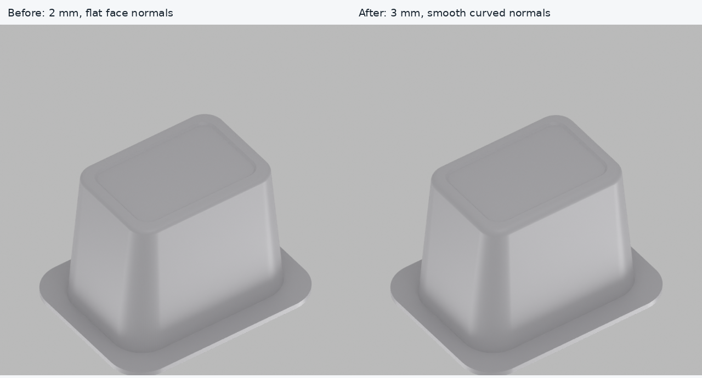
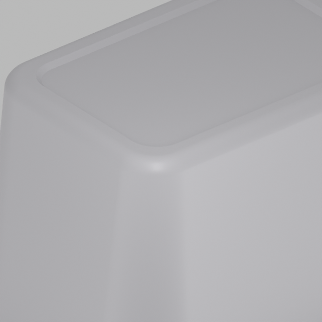
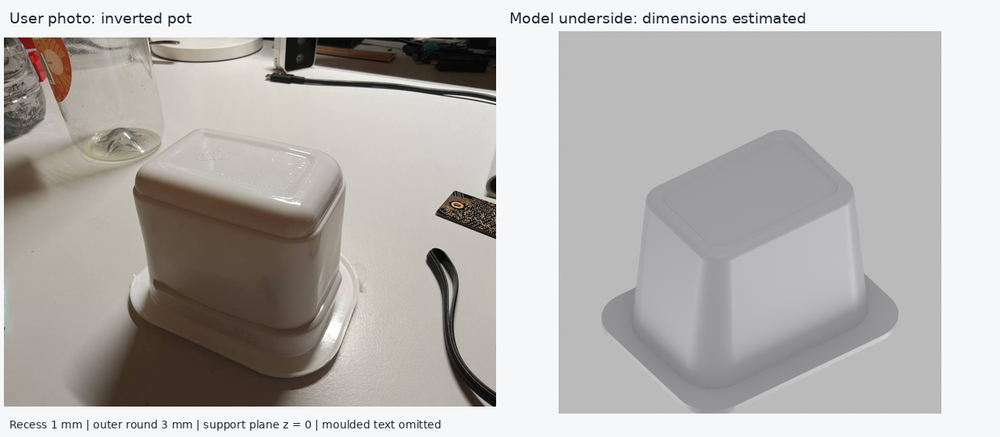
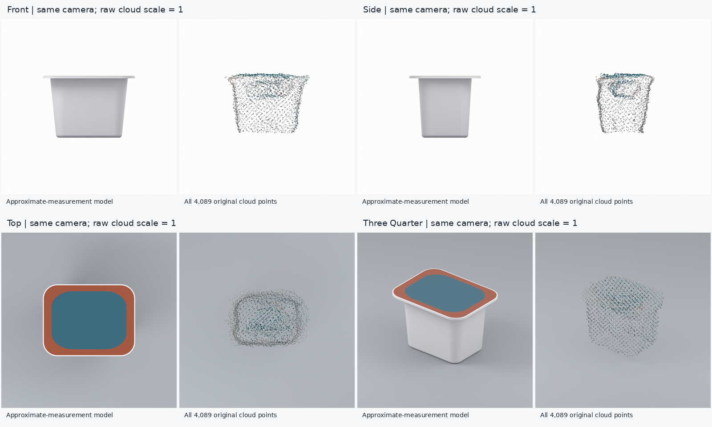
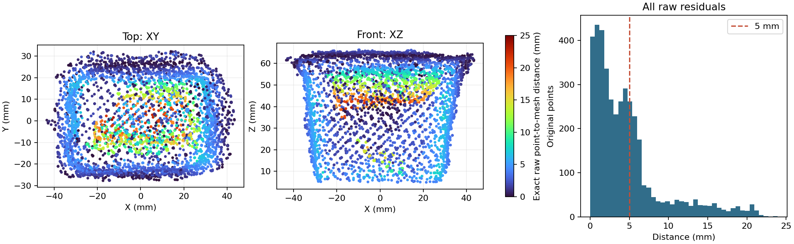

> Pruned for the public repo (16 Oct): the intermediate measurement rounds, candidate meshes,
> render sheets and the three `history/*.zip` snapshots this report refers to were moved out
> of the tree (41 MB -> 6 MB; kept locally, available on request). The asset itself, its
> parameters, the comparison images and the residual tables at this level are unchanged.

# Heinz Snap Pot — 3 mm bottom rounding revision

**Geometry and simulation import pass; physical accuracy remains unverified.**
The user supplied approximate dimensions: outer lid 95 x 74 mm, upper body
80 x 55 mm, base 68 x 48 mm, total height 63–64 mm, and a flat top assembly
about 2.5 mm thick. These replace the earlier cloud-only size estimates.
The previous assets and source are in `history/point_cloud_only_v1.zip`.

These are nominal anchors, not certified ruler ground truth. Height is the
reported range's 63.5 mm midpoint. All three original metric clouds were compared
at their original scale. Their height agrees, but their lateral dimensions do
not jointly agree with the new readings. Neither the cloud nor the entire model
is globally scaled to hide this disagreement.

Final untrimmed symmetric Chamfer: **4.570 mm mean,
12.584 mm P95**. This does not establish ±2 mm object accuracy.

## 3 mm bottom rounding revision

The new photo shows the pot upside down, with a rounded bottom perimeter and
a shallow central panel recess. The previous flat-base assets and source are
preserved in `history/measurement_flat_base_v2.zip`. The prior 2 mm rounded
version is in `history/bottom_photo_2mm_v3.zip`. At the user's request, the
current exterior has a 3 mm quarter-circle bottom profile, sampled at
24 uniform angular intervals. Analytic per-loop normals
smooth the curved surfaces and keep the lid's planar surfaces and edges sharp.
The 3 mm radius remains an unmeasured modelling estimate.

All new underside dimensions are **estimates from an unscaled photograph**:
outer round height/inset 3.0/3.0 mm,
recess depth 1.0 mm, recessed panel
56.0 x 36.0 mm,
panel corner radius 5.0 mm and recess-wall
bevel 1.0 mm. The outer base outline is still
68 x 48 mm, now defined at z=3.0 mm.
The estimated support contact outline at z=0 is
62 x 42 mm. Moulded lettering,
recycling marks and the fine circumferential seam are omitted.

The exported fillet profile was checked at 52
vertices; maximum deviation from the requested arc is
0.000002 mm. This confirms
explicit rounded geometry, rather than relying on shading to imply a round edge.

The collision union retains the recess: upward rays first hit the centre at
z=1.000 mm and the support land at
z=-0.000 mm. Across 50,000 visual
surface samples, maximum distance to the collision union is
0.585 mm.
This tests mesh consistency, not the true physical underside dimensions.
The CPU smoke test also checks that PhysX cooking preserves this centre gap.
Cooked centre depth is 1.000 mm;
maximum local support-height error across 37
test rays is 0.387 mm.
The previous 2 mm revision's strict 0.1 mm support-height diagnostic failed
because PhysX simplified thin support sectors; that historical result remains
in `maniskill_smoke_strict_diagnostic.json`. The current check uses the same 1 mm
surface-approximation budget as export QA, retains the separate 0.1 mm centre
gap check, and verifies stable z=0 settling. This cooking approximation is
not evidence of submillimetre physical accuracy.

The current result is round 1 in `verification_rounds/`.
The prior 2 mm revision's three rounds are in `bottom_2mm_verification_rounds/`;
those resolved near-coplanar BMesh slivers using double-precision Qhull.
The raw-cloud mismatch remains unresolved: a bottom-only change cannot resolve
the observed lateral size disagreement or missing underside coverage.

## Dimensions (mm)

| Dimension | Approximate user value | Exported mesh | Difference | Independent accuracy |
|---|---:|---:|---:|---|
| height_mm | 63.50 | 63.50 | +0.00000 | APPROXIMATE_ONLY |
| body_top_long_mm | 80.00 | 80.00 | -0.00000 | APPROXIMATE_ONLY |
| body_top_short_mm | 55.00 | 55.00 | -0.00000 | APPROXIMATE_ONLY |
| rim_long_mm | 95.00 | 95.00 | -0.00000 | APPROXIMATE_ONLY |
| rim_short_mm | 74.00 | 74.00 | +0.00000 | APPROXIMATE_ONLY |
| base_long_mm | 68.00 | 68.00 | +0.00000 | APPROXIMATE_ONLY |
| base_short_mm | 48.00 | 48.00 | +0.00000 | APPROXIMATE_ONLY |
| top_assembly_thickness_mm | 2.50 | 2.50 | +0.00000 | APPROXIMATE_ONLY |

Every export matches its nominal input within ±2 mm. Exact reproduction of
approximate readings is not independent validation; measurement uncertainty was
not supplied. **Top assembly thickness is 2.50 mm total**:
2.35 mm rim/plastic proxy plus an assumed 0.15 mm film.
The film inset remains 1.00 mm. The cloud and photographs support
a flat wider cap, but ±3–5 mm depth noise cannot independently verify a 2.5 mm
plate or the film thickness.

Base/body-top/rim corner radii: 8.73/
13.75/14.80 mm.
Rounding and pose are regularized from the exterior cloud; physical dimensions
are held nominal. Corner metrology remains uncertain under lateral disagreement.

## Comparison with raw clouds

Unconstrained exterior fits to the source clouds give these diagnostic dimensions:

| Source | Height | Upper body L x S | Base L x S | Rim L x S |
|---|---:|---:|---:|---:|
| beans_fuse_K_depth | 65.22 | 60.86 x 43.84 | 44.37 x 26.11 | 66.19 x 46.24 |
| beans_fuse_K | 64.04 | 73.11 x 55.43 | 56.10 x 39.86 | 78.40 x 57.43 |
| beans_fuse_none | 65.41 | 65.57 x 56.34 | 51.10 x 40.35 | 72.82 x 58.90 |

Height agreement with 63–64 mm and lateral disagreement argue against a single
global scale correction. Missing rim coverage, pose/fusion distortion and rough
measurement uncertainty remain possible contributors; a unique cause is not
established. The prior K+depth choice was based on per-view scale consistency,
which did not prove lateral accuracy.

Selected source: **`Gitignore-but-important/recon/beans_fuse_K/object.ply`**, 4,089 points.
SHA256: `872e820278111262ceb89276a9bcd33db841a4f4b66e3bed8b38a767c013fda3`.
This source had the lowest full symmetric mean in the preceding flat-base comparison.
All candidates come from one capture and are not independent validation.
The nonmetric `beans_global40` is excluded.

Pose refinement permits only XY translation and yaw; z=0 and scale=1 stay fixed.
The fit uses a 4 mm band inside 5 mm horizontal slice envelopes to suppress
interior ghost sheets. Regularization prevents physical-size disagreement from
creating extreme rounding or moving the model to match only one side.
**Every original point is retained in the final distances and renders.**

## Source-selection comparisons before the underside revision

| Candidate | Unscaled metric cloud | Symmetric mean mm | Symmetric P95 mm | Selection |
|---|---|---:|---:|---|
| 1 | beans_fuse_K_depth | 9.083 | 18.203 |  |
| 2 | beans_fuse_K | 4.684 | 12.725 | selected |
| 3 | beans_fuse_none | 5.915 | 15.785 |  |

These are historical flat-base metrics, not the current underside mesh's metrics.
Each candidate used identical nominal physical dimensions, with its own rigid
pose and regularized rounding fit. Original checks are in
`measurement_verification_rounds/` and `measurement_candidates/`. The underside
revision retains the selected source, scale and rigid alignment; its current
metrics appear below.

## Distances and regions above 5 mm

Cloud→mesh uses exact closest points on the exported triangles for all raw
points. Mesh→cloud uses 200,000 area-uniform exterior samples (seed 20261014)
and nearest raw points. Distances are unsquared Euclidean millimetres. Symmetric
mean and P95 give 0.5 weight to each direction, independent of sample count.
Reverse distances include errors due to missing coverage.

| Direction | Mean mm | P95 mm | Fraction >5 mm |
|---|---:|---:|---:|
| cloud_to_mesh | 4.662 | 15.580 | 32.9% |
| mesh_to_cloud | 4.478 | 10.167 | 37.8% |
| Equal-direction symmetric | 4.570 | 12.584 | — |

Raw points grouped by nearest model region:

| Region | Points | Mean mm | P95 mm | Points >5 mm |
|---|---:|---:|---:|---:|
| base | 84 | 7.165 | 13.415 | 62 |
| body | 2527 | 4.512 | 15.216 | 761 |
| rim_or_lid | 1478 | 4.778 | 16.565 | 523 |

- **Body/interior:** 1346 points lie >5 mm inside the model. This includes physical-size disagreement as well as visible ghost sheets; not all such errors can be dismissed as noise.
- **Outer scan regions:** 0 points lie >5 mm outside. Their exact coordinates and nearest regions are retained in `cloud_residuals.csv`.
- **Lid perimeter:** the 95 x 74 mm cap extends beyond the raw-cloud supports. Reverse distances along this overhang are large; the scan does not verify its size.
- **Base/lower sides:** the lowest raw z is 4.930 mm. Reverse distance over the underside and rounded transition (z <= 3.0 mm) is 7.817 mm mean / 13.639 mm P95. This region is missing from the scan, so the photo-supported recess depth cannot be verified from it.

For context, reverse distance excluding the base is
3.963 mm mean /
9.252 mm P95. It does not replace the full metric.

## Files, coordinates and simulation

- `visual.glb`: one closed exterior, 6600 triangles, photo-derived white/teal/orange palette.
- `collision.obj`: 35 named closed convex solids, preserving the flange overhang and central underside recess. Radial support sectors and horizontal body layers have disjoint interiors.
- `snap_pot.blend`: native scene, named dimension properties, packed texture, four cameras and raw reference cloud.
- `parameters.json` / `measurements_approx.json`: editable model and exact provenance of approximate readings.
- `comparison_4views.png`, `renders/`, `cameras.json`: four matched-camera pairs at identical scale.
- `verification.json`, `dimensions.csv`, `verification_rounds/`: current underside checks. `selection.json` records historical source-selection comparisons.
- `cloud_residuals.csv`, `residuals_over_5mm.ply`, `residual_map.png`: every point's error; red PLY points exceed 5 mm.
- `measurement_candidates/`: each comparison's parameters, exports and logs.

Units are **metres**, +Z up, +X along the long side. Origin is the support-plane centre
at z=0; import scale is `[1,1,1]`. Blender uses `export_yup=False`; generic glTF
viewers assuming Y-up may display this intentionally Z-up asset sideways.
All meshes have positive volume, consistent winding and closed topology;
collision parts are individually convex. The cap collision replaces the film's
inset step with a bevel within the film's 0.15 mm thickness.

ManiSkill CPU import and 4 cm drop: **PASS**.
Loaded shapes: 35; cooked vertex counts:
[27, 40, 6, 6, 6, 6, 6, 6, 6, 6, 6, 6, 6, 6, 6, 6, 6, 6, 6, 6, 6, 6, 6, 6, 6, 6, 6, 6, 6, 6, 6, 6, 6, 6, 27]; maximum cooked bound error:
0.000004 mm. Cooking can simplify local curvature.
Mass/friction are **test-only 0.2 kg/0.5**. Inertia is a uniform filled-envelope
proxy. Blender checks visuals; the CPU test disables Vulkan visual loading.
Panda grasp, approach clearance, stiffness, lid peeling and force calibration
remain untested.

For an **80 mm Panda opening**, nominal lid short-side clearance is
**6.0 mm total**; its 95 mm long dimension exceeds the opening.
The body just below the lid offers **25.0 mm total**
short-side clearance. The 80 mm body long side has zero nominal clearance.
These dimensions do not certify a grasp or a collision-free approach.

## Assumptions and remaining uncertainty

- User dimensions are approximate nominal anchors, not certified ruler ground truth; their uncertainty was not supplied.
- Total height is 63.5 mm, the midpoint of the reported 63-64 mm range.
- The 2.5 mm flat top assembly includes rim plastic and film; it does not mean 2.5 mm film.
- Film thickness 0.15 mm and film inset 1.0 mm remain unresolved appearance/geometry assumptions; rim plastic is derived as 2.35 mm.
- Corners use a regularized exterior-cloud estimate; lateral size disagreement prevents reliable corner metrology.
- Raw cloud is rigidly aligned in XY/yaw only; no isotropic or anisotropic rescaling, Z offset, cropping or residual trimming.
- Significant lateral disagreement with raw fused depth remains; repeated internal surfaces and incomplete coverage do not fully explain physical scale.
- Nominal dimensions are retained instead of shrinking to incompatible depth; actual dimensions may differ from these approximate readings.
- Bottom photo supports a shallow recessed central panel, perimeter support land, and rounded outer transition. Recess depth 1 mm, transition height/inset 3 mm, panel 56 x 36 mm, panel corner radius 5 mm and recess-wall bevel 1 mm are unmeasured estimates.
- Base 68 x 48 mm means maximum lower-body outline at z=3 mm; nominal contact outline is 62 x 42 mm at z=0. Origin remains the centre of the support plane.
- Body tapers linearly from the outer base outline at z=3 mm to the measured shoulder. No internal cavity, contents or hidden ribs are modelled.
- Moulded underside text, recycling mark and fine seam are omitted; they are not resolved by the metric scan.
- The user approved a 3 mm bottom-round estimate. Circular fillet sections are sampled at 24 uniform arc intervals; analytic split normals smooth curved surfaces while preserving cap and lid edges. Radius remains unmeasured.

The same 40-frame orbit capture supplies appearance. Six original frames are
in `source_views.jpg`; colours are sampled from frame 0037. Lettering and detailed
artwork are not recreated, and illumination-independent reflectance is unmeasured.

