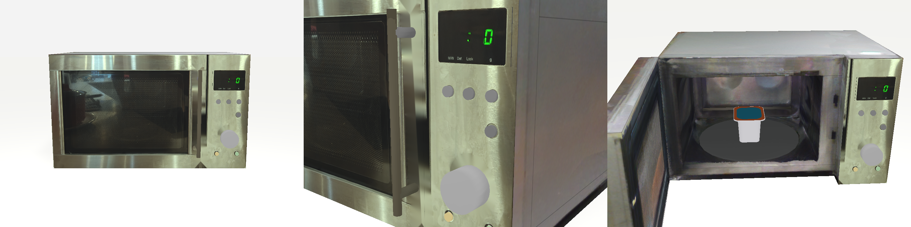

# Microwave: measured, articulated, scan-coloured



The microwave on my kitchen counter as a URDF: a fixed body with an open cavity and a
turntable, one door on a vertical hinge with a bar handle, and the control panel's
display, buttons and knob as fixed shapes. **Geometry is tape-measured; the scan only
supplies colour** (and the check that the measurements agree with the sensor).

| file | what |
|---|---|
| `build_microwave.py` | the generator: every dimension with its source -> `microwave.urdf`, `parameters.json` |
| `microwave.urdf` | plain colours (collision = visual boxes / cylinders) |
| `microwave_textured.urdf` + `textured/` | same geometry, visuals = `body.glb` / `door.glb` with baked colour atlases |
| `parameters.json` | all values with their sources, plus derived positions (cavity, turntable, handle) |
| `check_microwave.py` | loads it in SAPIEN with the Snap Pot: hinge direction and limit, pot resting on the turntable, door holding an angle, render -> `renders/check.png` |
| `front_photo.jpg`, `make_front_mask.py`, `front_photo_mask.png` | straight-on photo for the front decal; the handle and knob are masked out of it (they stand proud and would show parallax) |
| `renders/` | `textured.png` (above), `panel_vs_photo.png` (controls placed against the photo) |

## Frame

Metres, z up. Origin on the counter under the body's front-left corner; +x to the right
along the front face, +y into the microwave, door in front of y = 0. Joint `door_hinge`:
axis -z at the front-left corner, q = 0 closed, q > 0 opens outward to the left, limit
1.75 rad. The simulation (`sim/microwave_env.py`) and everything extracted from the human
takes (`recon/DEMOS.md`) use this frame.

## Where the numbers come from

26 parameters: **17 measured** (tape, 2026-10-14), **2 from the photo** (scaled against
the measured 46 cm width), **7 guessed**:

| guessed | value | matters for |
|---|---|---|
| `door_max_angle` | 1.75 rad (~100 deg) | how far the door can be pushed |
| `door_mass` | 1.0 kg | door dynamics while carried round |
| `hinge_damping`, `hinge_friction` | 0.05, 0.05 N m | how the door swings when released or brushed -- kept light, as the real hinge is, rather than stiffened to hide the arm brushing it |
| `turntable_diameter` | 0.245 m | where "on the turntable" ends |
| `cavity_recess_inset`, `back_shell` | 0.020, 0.005 m | the back bump only |

The body mass (12 kg) is also not measured; the body is fixed in simulation, so it does
not matter. Sensor cross-check after the second measurement (`recon/ASSET_ISSUES.md`):
height 27.9 cm in single depth frames vs 27.5-28 cm taped; overall depth 30-31.6 cm vs
31-32 cm taped.

The control panel's parts are placed at their pixel positions in `front_photo.jpg`
through the same homography as the decal (+-2 mm).

## Colour

`recon/scan_to_textured.sh` (shots `closed` and `open_90`): per-frame camera poses by
registering each RealSense frame's own depth to this model (`recon/frame_poses.py`;
2.0-2.2 mm rmse, 79 / 80 frames kept), then `recon/bake_colors.py` projects every texel
into every frame where the model says it is visible, and takes the median. The front
is the photo decal, colour-matched to the scan.

Texels no frame saw are inpainted. Coverage (`textured/coverage.json`) is above 80 % on
the faces that matter -- door panel 99 %, door window 93 %, handle 96 %, control panel
93 %, cavity side walls ~90 % -- and low where the camera did not look: cavity floor 23 %,
under the recess 19 %, turntable 49 %, feet 0 %.

## Rebuild

```bash
python assets/microwave/build_microwave.py          # microwave.urdf + parameters.json
python assets/microwave/check_microwave.py          # renders/check.png
bash recon/scan_to_textured.sh <scan dir> assets/microwave/microwave.urdf <work dir> closed open_90
```

`build_microwave.py` rewrites only the plain URDF. The textured URDF is written by the
bake; its joint dynamics were set to the generator's values (friction 0.05) by hand after
the last bake, so re-bake after changing any dynamics in the generator.
